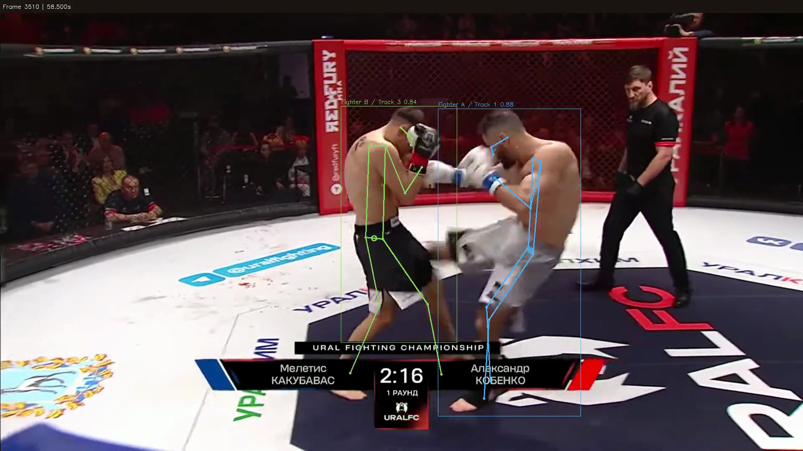

# M.A.S.A. v1.0 - Martial Arts Skeletal Annotation


M.A.S.A. turns a video into tracked 2D pose observations, reviewable overlays, and exportable measurements. It is a local first inspection tool, NOT a strike classifier(yet), verified (yet)fighter-identity system(yet), or fight outcome predictor(will be hopefully).

## What I've built

- A native browser interface and Python CLI that share the same analysis pipeline.
- Video inspection, source frame seeking and export, bounded clip analysis, pretrained pose estimation, tracking, review flags, and original/annotated frame comparison.
- Manual Fighter A/B selection tied to boxes on the first analyzed frame(needs the most patches for the next version). Selected tracks are retained without substituting spectators. Automatic person count mode does not identify fighters.
- Experimental hip center movement traces, approach contributions, phase navigation, and downloadable human review judgments. These are heuristic image-plane measurements, not validated action labels.
- Per run provenance and five outputs: `manifest.json`, `poses.jsonl`, `features.csv`, `overlay.mp4`, and `contact_sheet.jpg`. The ZIP excludes the source video but includes derived imagery.
- All of the above wrapped in my personal identity style palette.

To run it, install Python 3.11 and [uv](https://docs.astral.sh/uv/), then run:

```bash
uv sync --frozen --python 3.11
uv run masa-web
```

Open `http://127.0.0.1:8501`. You can also use `uv run python app.py`. The server binds to loopback; do not expose it to an untrusted network. The first use of an uncached model downloads official pretrained weights. Inference runs on the host, while dependencies and model downloads may require internet access. The app opts out of Ultralytics usage telemetry within its project-scoped settings; this is not a zero-network guarantee.

Upload a clip or select a path on the server machine. Confirm that you have permission to process the footage, select the interval and settings, then review and export the run. Uploads are limited to 200 MiB and analysis intervals to 120 seconds. For command-line use, try `uv run masa inspect /path/to/clip.mp4` or `uv run masa analyze --help`. Analysis outputs must go to a new directory; existing runs are not overwritten.

## What's novel for v1.0

M.A.S.A. focuses on making pose analysis results inspectable and traceable rather than presenting model output as ground truth. The browser and CLI use one analysis pipelin, source frame timing, confidence, missing observations, uncertainty flags, model/input hashes, and run settings travel with the exported results. Missing measurements remain missing instead of being replaced with zero.

For two manually selected fighters, the experimental movement view links heuristic hip center evidence and phase labels back to source frames. Human review is kept separate from generated labels and can be downloaded with run and source identifiers. The app also makes its processing boundaries explicit: uploaded video goes to the local server, derived imagery appears in exports, and a track ID does not prove identity.

## What's left to do
Well...many things
- Collect rights cleared fight footage and build reviewed annotations with clear provenance.
- Measure pose quality, track continuity, fighter selection, and movement labels against human reviewed ground truth across varied clips and camera setups.
- Improve identity correction and handling of occlusion, scene changes, cropped bodies, camera movement, and variable frame rate timing.
- Validate movement heuristics on independent fixed-camera footage; current labels and thresholds are not calibrated or accuracy claims.
- Decide on a repository wide distribution license and review the applicable Ultralytics software/model terms before redistribution.
- Since we are working with human footage it's needed to establish operational safeguards and retention policies before considering any deployment beyond a trusted local machine.

Feel free to fork the repo and experiment for yourself!
